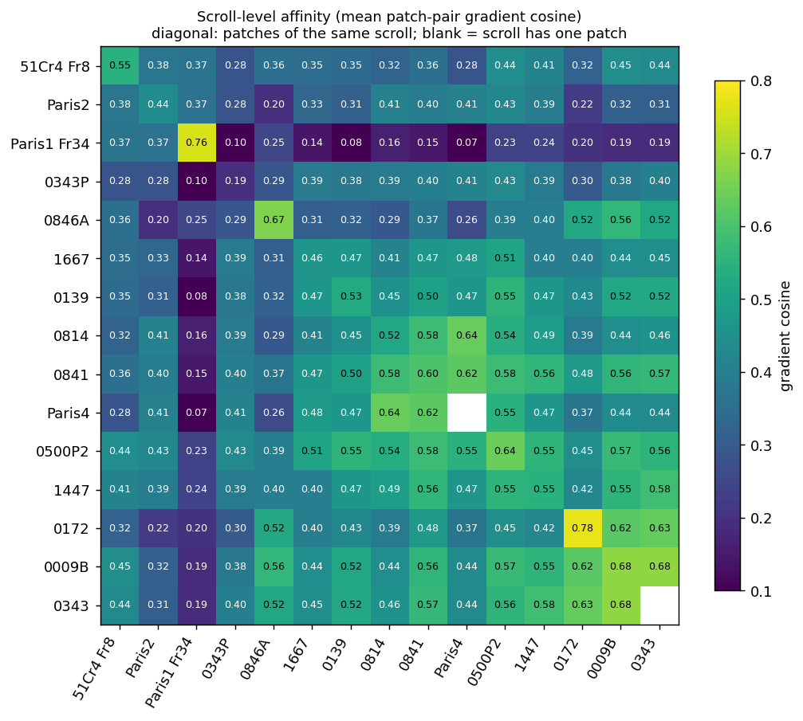
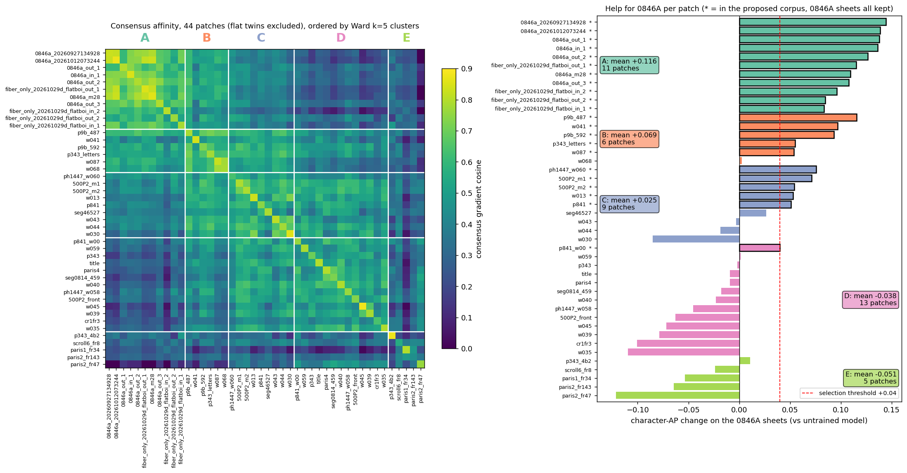

# Patch correlation study: summary (2026-11-01)

49 patches from 15 scrolls, each trained alone for 3 epochs from the same weights, then probed on every patch (48 batches per target, 16 eval batches). Source: `report.md` and the CSVs in this folder; figures in `figures/` (regenerated 2026-11-01 for the 49 patches; `python3 runs_corr/summary_figures.py`, `flat_comparison.py`, `cluster_figure.py`).

- **ΔAP** of a source patch = character AP of its single-patch model on the 11 trained 0846A sheets minus the untrained model's, averaged over the sheets (10 when the source is itself a sheet). **Helps / hurts** counts sheets with ΔAP above +0.05 / below −0.05. **Affinity** = consensus gradient cosine between two patches (own split-half ≈ 0.8, typical cross-scroll pair 0.40).
- Probe reliability 0.81 split-half (0.90 full). Same-scroll affinity 0.417 against 0.225 across scrolls (p = 3e-19). Gradient geometry predicts transfer only weakly (Spearman ≤ 0.09), so transfer (ΔAP) decides selection and affinity is secondary.

## 1. Final proposal for the next mix run

**Train on 22 patches: the 11 PHerc0846A sheets (unchanged) plus 11 donors.** Donors: 0009B 487 and 592, 0139 w041, 1447 w060, 0500P2 -1 and -2, 0343 first letters, 0172 w087, 1667 w013, 0841 405 and 0841 w00. **Versus mix25, remove three patches:** 0139 title, 0814 459 and 0814 seg46527 (the whole PHerc0814 domain). Nothing is added: the top 11 donors by ΔAP are exactly this set. The rule was ΔAP ≥ +0.04 with a 95% interval (bootstrap over the 11 sheets) above zero and no more than one hurt sheet.

| Donor | ΔAP [95% interval] | Helps / hurts (of 11) | ΔLoss | In mix6 | In mix25 |
|---|---:|---|---:|:-:|:-:|
| 0009B 487 | +0.116 [+0.093, +0.137] | 11 / 0 | −0.04 | yes | yes |
| 0139 w041 | +0.097 [+0.079, +0.115] | 10 / 0 | +0.06 | | yes |
| 0009B 592 | +0.093 [+0.066, +0.119] | 8 / 0 | +0.01 | | yes |
| 1447 w060 | +0.076 [+0.056, +0.099] | 8 / 0 | 0.00 | yes | yes |
| 0500P2 -1 | +0.071 [+0.059, +0.084] | 9 / 0 | −0.01 | | yes |
| 0343 first letters | +0.055 [+0.033, +0.075] | 7 / 0 | +0.07 | yes | yes |
| 0500P2 -2 | +0.054 [+0.024, +0.081] | 7 / 1 | −0.01 | | yes |
| 0172 w087 | +0.054 [+0.034, +0.074] | 6 / 0 | +0.29 | yes | yes |
| 1667 w013 | +0.053 [+0.040, +0.065] | 6 / 0 | +0.05 | | yes |
| 0841 405 | +0.051 [+0.029, +0.078] | 3 / 0 | +0.10 | yes | yes |
| 0841 w00 | +0.040 [+0.021, +0.057] | 5 / 0 | 0.00 | | yes |
| *Removed: 0814 seg46527* | +0.026 [+0.018, +0.035] | 1 / 0 | −0.02 | yes | yes |
| *Removed: 0139 title* | −0.009 [−0.024, +0.009] | 1 / 1 | +0.05 | | yes |
| *Removed: 0814 459* | −0.018 [−0.034, −0.002] | 0 / 2 | +0.07 | | yes |
| *Not used: 0172 w068* | +0.003 [−0.018, +0.022] | 2 / 1 | +0.32 | yes | |
| *Not used: 1447 w058* | −0.045 [−0.07, −0.02] | 0 / 4 | +0.05 | yes | |

| Corpus (donor part) | mix6 | mix25 | Proposed |
|---|---|---|---|
| Patches (0846A sheets + donors) | 15 (7 + 8) | 25 (11 + 14) | 22 (11 + 11) |
| Donor scrolls | 6 | 9 | 8 |
| Mean donor ΔAP on the 11 sheets [95%] | +0.042 [+0.031, +0.053] | +0.054 [+0.042, +0.066] | **+0.069 [+0.055, +0.084]** |
| Same on the 4 fibre neighbours of the prize sheet | +0.045 | +0.056 | +0.069 |
| Sum of donor ΔAP | +0.34 | +0.76 | +0.76 |
| Weakest sheet's mean donor ΔAP | +0.005 | +0.018 | +0.029 |
| Donor × sheet cells hurting by > 0.05 | 5 of 88 | 4 of 154 | 1 of 121 |
| Lowest donor lower bound | −0.07 (w058) | −0.034 (459) | +0.021 (w00) |

- **Paired by sheet** (mean donor ΔAP of the corpus on each of the 11 sheets): proposed − mix25 = +0.015 (better on 11 of 11 sheets, Wilcoxon p = 0.001); proposed − mix6 = +0.027 (11 of 11); mix25 − mix6 = +0.012 (9 of 11, p = 0.007).
- **How to read this:** the mean is higher partly by construction, because the proposal is the top 11. The honest statement is the **sum**: if donor effects add, the proposal gives the same total donor help as mix25 (+0.76) with three fewer patches, and the removed three are worth about zero (title, 459) or +0.026 (seg46527). mix25 over mix6 is a real gain (+0.34 to +0.76). The additive reading is untested; run a co-training pilot before trusting a gap of 0.01.
- **0846A sheets:** all 11 stay. Each helps the others (+0.08 to +0.14, 0 hurt), and even the weakest (fibre in_1, +0.083) beats 8 of the 11 donors.
- **Why not w068, though it clusters with w087.** They are the two PHerc0172 patches (affinity 0.78) and sit in the same cluster. The decision comes from transfer: w087 beats w068 on 9 of 11 sheets (+0.054 against +0.003, paired difference +0.051, p ≈ 0.006 over correlated sheets). Both are miscalibrated on 0846A (ΔLoss +0.29, +0.33) and both end training pointing against the sheets (−0.31, −0.56). w068 is a better helper for other scrolls (+0.070 against +0.034) and gives w087 +0.35. Leaving it out is a weak call; both were in mix6.
- **Why not seg46527.** It is harmless (no hurt sheet) but helps one sheet of eleven and falls below the +0.04 rule. Its link to the other 0814 patch is only moderate (affinity 0.52, 71st percentile of pairs; the two help each other by +0.06 / +0.09). The cost is that PHerc0814 leaves the corpus; keep seg46527 as a single patch if coverage of other scrolls matters more than the 0846A score.
- **Code and sampling:** drop the `pherc0814` domain and `20260422000000` (title) from `DOMAINS` and `SEGMENTS` in `utils/mix6.py`. Domain weights stay (0846A 2, donors 1 each): 0846A becomes 20% of cue_dropout draws (18% before) and each donor scroll 10%. Reader-v3's batch of 13 (0846A 4 + 9 donor scrolls) falls to 12 with 8 donor scrolls; give 0009B a second slot (it has two patches and the highest ΔAP) to stay at 13.

## 2. Ranking of every donor for 0846A

| # | Patch | ΔAP | Affinity | Helps / hurts |
|---|---|---:|---:|---|
| 1–11 | the proposed donors, order as in section 1 | +0.116 … +0.040 | 0.34–0.60 | |
| 12 | 0814 seg46527 | +0.026 | 0.37 | 9% / 0% |
| 13 | 0343P -4_b2 | +0.011 | 0.34 | 18% / 9% |
| 14 | 0172 w068 | +0.003 | 0.50 | 18% / 9% |
| 15–23 | 0139 w059, Fr8 (flat), 0343P tifxyz, 0139 w043, 0139 title, Paris4, 0814 459, 0139 w044, 0139 w040 | +0.002 … −0.023 | 0.21–0.41 | neutral |
| 24–26 | Fr8, Cr1Fr3 (flat), 1447 w058 | −0.024 … −0.045 | 0.31–0.34 | up to 36% hurt |
| 27–38 | Paris1 Fr34 (both), Paris2 Fr143 (both), 0500P2 front, 0139 w045 / w039 / w030 / w035, Cr1Fr3, Paris2 Fr47 (both) | −0.053 … −0.121 | 0.06–0.32 | 45–100% hurt |

- **Order of value:** 0846A sheets (+0.08 to +0.14) > bridge (0009B, w041, w060, +0.08 to +0.12) > the 0500P2 pair, 343 letters, w087, w013, 0841 (+0.04 to +0.07) > neutral > harmful.
- **Robust:** the ranking on the four fibre neighbours alone has Spearman 0.98 with the all-sheet ranking; ΔPR-AUC gives the same top 11.
- **Harmful:** every detached Paris fragment and Cr1Fr3 (−0.05 to −0.12, Fr47 worst even with a flat window), 0500P2 front (−0.063, hurts 8 of 11) and four 0139 windings. Paris4, in-scroll, is neutral (−0.009); it is dropped for lack of benefit.
- **Calibration:** w087, w068, w030 and Cr1Fr3 raise the 0846A eval loss by about +0.3 even when AP is unchanged, so scores are shifted.
- **Detached fragments** give almost nothing to segments (mean ΔAP −0.006, 12% hurt) while receiving +0.071 from them. A flat window at the intensity peak removes most of Cr1Fr3's harm (−0.100 → −0.016) and moves Fr8 toward 0846A (affinity 0.31 → 0.41) at a 0.04–0.14 cost to their own AP; Paris fragments do not change ([figure](figures/11_flat_vs_detected.png)).
- **w018** is not in the study (unreadable volume, now a missing `.matched` zarr), so there is no evidence for or against it; its sibling w013 helps (+0.053).

## 3. How strongly patches and scrolls correlate

**500P2:** -1 and -2 correlate strongly with each other (0.704, 24th of 946 patch pairs). The front is not poor in gradient terms (0.61 with either, 91st percentile) but it is harmful as a donor.

| Pair | Affinity | Rank of 946 | Transfer ΔAP (source → target) |
|---|---:|---:|---|
| -1 ↔ -2 | 0.704 | 24 | +0.064; +0.070 |
| front ↔ -2 | 0.614 | 80 | front → -2 +0.061; -2 → front +0.092 |
| front ↔ -1 | 0.610 | 87 | front → -1 −0.011; -1 → front +0.080 |

The front's affinity to 0846A is 0.32 (against 0.42 and 0.44) and its ΔAP there is −0.063 (against +0.071 and +0.054); -1 and -2 help the front, the front gives nothing back.

- **Within a scroll (mean pair affinity):** 0172 0.78 (w068 ↔ w087, 7th highest pair), 0009B 0.68, 0846A 0.67 (highest: 073244 ↔ m28 0.83), 0500P2 0.64, 0841 0.60 (the pair helps each other 0.00), 1447 0.55, 0139 0.53 (10 windings, 0.25 to 0.70), 0814 0.52, 1667 0.46, Paris2 0.36, 0343P **0.19** (the lowest same-scroll pair; its two patches are unrelated).
- **Between scrolls, highest:** 0009B–0343 letters 0.68, 0814–Paris4 0.64, 0172–0343 letters 0.63, 0841–Paris4 0.62, 0009B–0172 0.62. **Lowest:** 0846A–Paris2 0.17, 0841–Paris1 0.16, 1667–Paris1 0.11, 0343P–Paris1 0.11, 0139–Paris1 0.10, Paris1–Paris4 0.09.
- **Closest scrolls to 0846A:** 0009B 0.56, 0172 0.52, 0343 letters 0.52, then 1447 0.40, 0500P2 0.39, 0841 0.37; 0139 only 0.32.
- **Patch pairs:** highest across scrolls are 0139 w030 ↔ 1667 w013 0.72 (no transfer, ΔAP +0.005), 0009B 487 ↔ 343 letters 0.71 (ΔAP +0.24), 487 ↔ w068 0.69, Paris4 ↔ 459 0.69, 487 ↔ w087 0.68. All ten lowest involve a Paris fragment (Fr47 ↔ fibre in_2 −0.09). High affinity does not guarantee help.
- Paris1 Fr34 is the most isolated patch (0.09–0.25 to everything except Fr8 and Paris2).

## 4. Clusters (k ≥ 3)

Silhouette is best at k = 2 (fragments against everything else, 0.21). For k ≥ 3, Ward on the rows of the consensus matrix was the most stable method (bootstrap ARI at k = 5: 0.67, p10 0.48), against average linkage 0.71 (p10 0.30, mostly singletons) and spectral 0.56 (p10 0.34, splits the 0846A sheets). Its silhouette is low (0.10), so only the coarse structure is firm. The clusters use gradient geometry only; their order by measured help was not an input, which makes it an independent check.

| Cluster | Members | Within / between affinity | Stability | Mean ΔAP | Hurts | Use |
|---|---|---|---:|---:|---:|---|
| **A: 0846A** | all 11 sheets | 0.67 / 0.35 | 0.92 | +0.116 | 0% | core |
| **B: bridge** | 0009B 487 and 592, 0139 w041, 0172 w068 and w087, 343 letters | 0.62 / 0.46 | 0.89 | +0.069 | 2% | use (not w068) |
| **C: compatible pool** | 0139 w030, w043, w044; 0500P2 -1, -2; 0841 405; 1447 w060; 1667 w013; 0814 seg46527 | 0.56 / 0.45 | 0.72 | +0.025 | 13% | use the helpers (-1, -2, w060, w013, 405); w030 hurts (−0.085) |
| **D: neutral to harmful** | 0139 w035, w039, w040, w045, w059, title; 0343P tifxyz; 0500P2 front; 0841 w00; 1447 w058; Cr1Fr3; Paris4; 0814 459 | 0.52 / 0.37 | 0.73 | −0.038 | 38% | leave out (w00 is the exception) |
| **E: detached fragments** | Fr8, Paris1 Fr34, Paris2 Fr143, Paris2 Fr47, 0343P -4_b2 | 0.30 / 0.29 | 0.60 | −0.051 | 45% | leave out |

- **Coarser and finer:** k = 3 merges B + C (15 patches, +0.043) and D + E (18, −0.041, 40% hurt); k = 4 keeps D and E apart (most stable k ≥ 4: ARI 0.68, p10 0.45); k = 6 isolates Paris2 Fr47 (ΔAP −0.121).
- **Flat twins** follow their detected version except Fr8 (flat), which joins A, and Paris2 Fr47 (flat), which moves from E to D.
- **PHerc0139 is not one cluster:** w041 is in B, w030 / w043 / w044 in C, the other six in D. Scroll name is a poor grouping beyond 0846A; w041 is a top-two donor and w035 the worst 0139 patch.
- **Least certain members:** Paris2 Fr47 (0.42), Paris1 Fr34 (0.45), Cr1Fr3 (0.49), seg46527 (0.55), 1447 w060 (0.62), w045 (0.63), w059 (0.64); fibre out_2 is the weakest sheet (0.73).

## 5. Caveats

- ΔAP is a single-patch screen; corpus comparisons assume donor effects add. The eval noise floor and seed variance were not measured, so ranks within about 0.02 ΔAP are not separable.
- The 0846A targets are train-only, so scores are on unaugmented training windows of the target. Neighbouring sheets read almost the same voxels, so sheet-to-sheet help is partly shared input. The prize sheet and its exclusion zone are not in the study.
- 13 patches are skipped in `patches.csv` (nine unlabeled 0139 windings, w018, straightened2, `fiber_only_20261030_flatboi`, ph1447 w062); `report.md` says 11.
- The 343 first letters are PHerc0343, not 0343P. This was wrong in the plan (inherited from the plain `Config()` groups) and is fixed in `plan.json`, `patches.csv`, `corr_runs.py` and the report. `utils/config.py` still groups them under `pherc0343p` for the plain `Config()`; the mix runs use `DOMAINS` in `utils/mix6.py` and are not affected.
- Earlier rounds (33 and 40 patches) are in `../report_v1/`; their conclusions about group structure, layer-wise agreement (scroll identity lives in the input-facing layers, decoder agrees across scrolls; the text-region head memorises each patch) and the late-training conflicts still hold.
